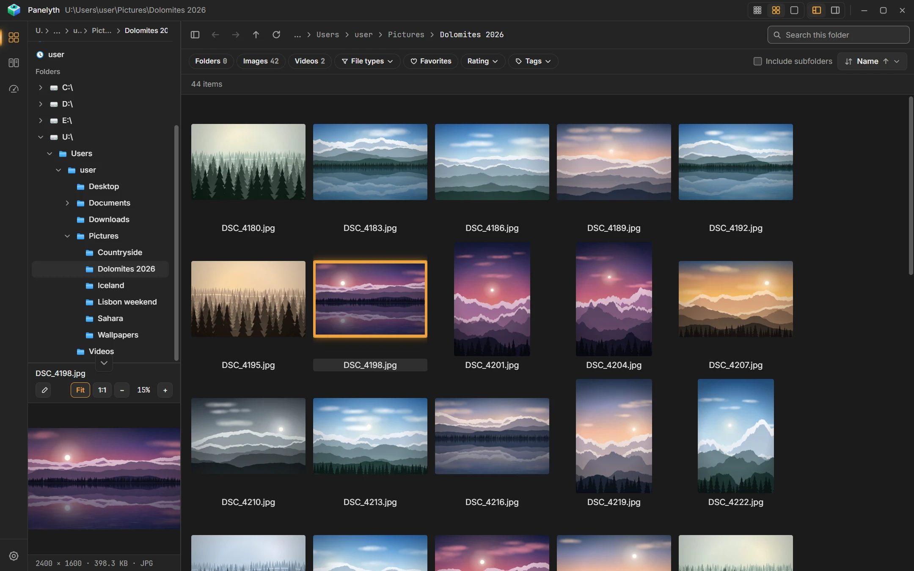
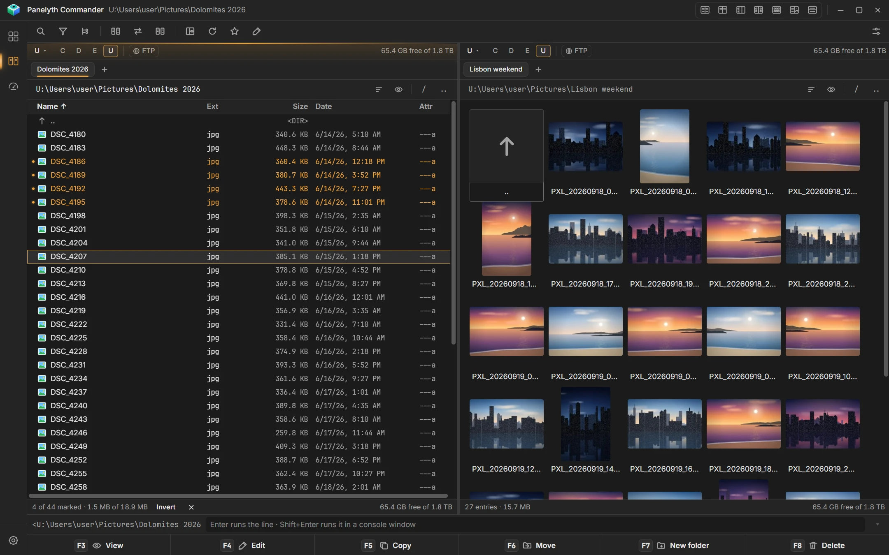
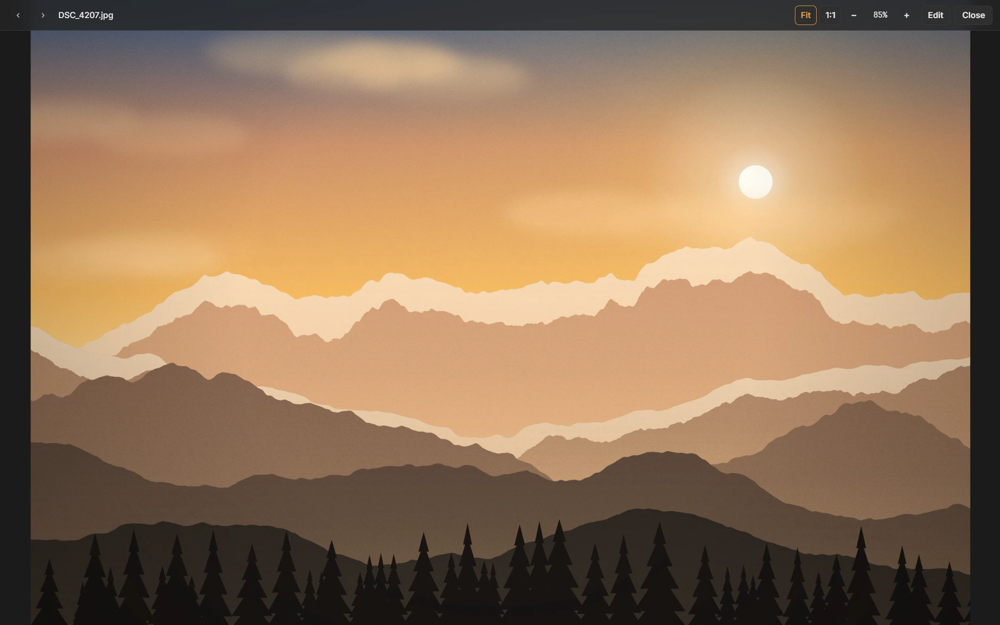
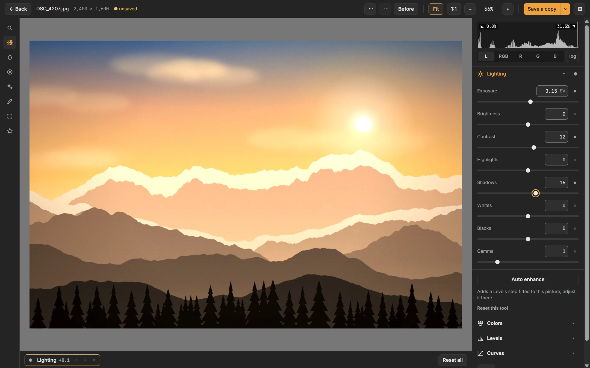
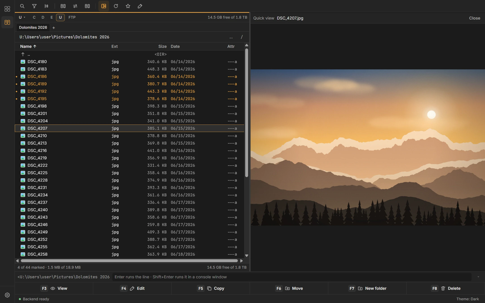
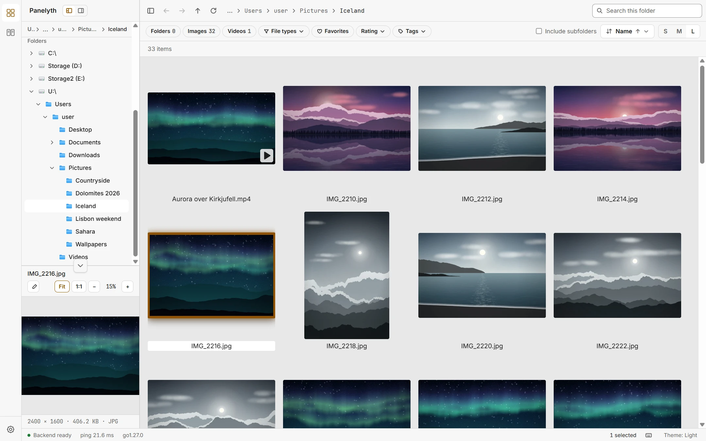

# Panelyth — Product Family

Fast, local-first desktop apps for Windows, macOS and Linux, built on one platform and hosted by one shell
(ADR-0025, ADR-0031):

- **Panelyth** — the photo and video viewer: a tile view that stays fluid in folders with hundreds of thousands of
  images, a persistent preview cache, a focused viewer and local video playback.
- **Panelyth Commander** (working title, planned) — a keyboard-first, dual-panel file manager in the style of Total
  Commander: two folders side by side, background file operations, find, archives, compare and multi-rename.

The two apps live in one window. A left rail switches between them, and the other app opens
where you are: same folder, same file, same selection. Bookmarks, recent folders, appearance and the file clipboard
are shared (`docs/shared/APP-SWITCHING.md`).

## Screenshots

The viewer: a folder as tiles, with the folder tree and the preview of the selected picture beside it.



The commander: two panels, here the Full view with marked files on the left and the Thumbnails view on the right.



<p>
  
  
</p>
<p>
  
  
</p>

One picture in the media window and the image editor; the commander's quick view and the viewer in the light theme.

The screenshots are taken from the app itself, on a library of generated pictures, and are shared with the product
page; `showcase/README.md` says how to take them again.

Both apps share the platform:

- Go sidecar for filesystem indexing, metadata, thumbnail generation, cache and file operations
- React renderer inside Electron
- Electron main process only for desktop lifecycle, secure IPC and native integrations
- persistent preview cache on the user's OS cache drive
- large-directory support through virtualization and index-backed paging
- keyboard-first navigation
- cross-platform packaging
- performance treated as a first-class product requirement

## Development

Prerequisites: Node ≥ 22.12, pnpm 10, Go (current stable).

```sh
pnpm install
pnpm dev            # sidecar + Electron + Vite dev server (renderer HMR)
pnpm build          # sidecar + main/preload + renderer
pnpm start          # run the production build unpackaged
pnpm lint           # eslint + prettier + gofmt + go vet
pnpm typecheck
pnpm test           # contracts, desktop, renderer, Go
pnpm test:e2e       # Playwright against the built Electron app
BENCH_STAGE=02 pnpm bench:startup   # startup / idle memory / IPC → src/shared/bench/results/ (never overwrites)
BENCH_STAGE=02 pnpm bench:index     # scan / write batches / paging on 100k files
BENCH_STAGE=02 pnpm bench:previews  # thumbnail throughput, cache hits, coalescing
pnpm bench:go       # Go micro-benchmarks
pnpm package        # installers for this OS (docs/RELEASING.md); --dir for the unpacked app
pnpm test:smoke     # the packaged smoke test
```

These commands build and run the shell with the viewer. The commander joins them in Stage C00, behind a feature
flag (`PANELYTH_COMMANDER=1`). Stage P01 lets `BENCH_STAGE` take platform and commander stage IDs (`P01`, `C03`).

Logs: Electron `app.getPath("logs")/panelyth.log` (main process and sidecar stderr).

## Documentation map

```text
CLAUDE.md                      working rules for Claude Code (stays in the repository root)
docs/
  README.md                    this file: overview, map, reading order, ADR index
  ROADMAP.md                   phases of every track and the order across tracks
  DEVELOPMENT-STAGES.md        stage gates, stage IDs, sequence, completed and active stages
  STAGE-TEMPLATE.md            template for new stage documents
  RELEASING.md                 how a release is built, signed, tested and published; the release rules
  INSTALL.md                   for users: install, update, data locations, uninstall, known limits
  shared/                      the platform, used by both apps
    REQUIREMENTS.md            platform requirements (FR-20, FR-21, NFR-01…NFR-14)
    PRODUCT-PRINCIPLES.md
    ARCHITECTURE.md            processes, sidecar, IPC, index, jobs, watching
    ARCHITECTURE-ANALYSIS.md   historical Stage 00 analysis
    DOMAIN-API.md              renderer-facing API map
    CACHE-DESIGN.md            preview cache contract
    PERFORMANCE.md             strategy and platform budgets
    TESTING.md                 layers, harness, fixtures, benchmarks
    DESIGN-SYSTEM.md           tokens, themes, typography, motion, keyboard foundation, app switch rail
    APP-SWITCHING.md           the switch between the apps and the state they share
    decisions/                 shared ADRs
    stages/                    platform stages P01…P06
  viewer/                      Panelyth (photo and video viewer)
    BRS.md                     viewer requirements (FR-01…FR-19, FR-23)
    FEATURE-MATRIX.md
    ARCHITECTURE.md            workspace, tile view, preview pane, focused viewer
    UX-DESIGN.md
    PERFORMANCE.md             viewer budgets and recorded baselines
    TESTING.md                 viewer e2e scenarios and fixtures
    decisions/                 viewer ADRs
    IMAGE-EDITOR.md            image editor spec: features, UX, batch, stages 12–16
    stages/                    viewer stages 00…08.6 and 12…16
  commander/                   Panelyth Commander (dual-panel file manager)
    BRS.md                     commander requirements (CFR-01…, CNFR-01…)
    FEATURE-MATRIX.md          Total Commander features → stages
    ARCHITECTURE.md            panels, listing, file operations, lister, archives
    UX-DESIGN.md               layout, panels, dialogs, default key map
    PERFORMANCE.md             commander budgets
    TESTING.md                 commander e2e scenarios, fixtures, safety tests
    decisions/                 commander ADRs
    stages/                    commander stages C00…C11 (C10.5 between C10 and C11)
```

Rules for placing a document: shared platform behavior goes to `docs/shared/`; anything only one app has goes to that
app's folder. ADR numbers are global across the folders. Paths in documents are written from the repository root
(`docs/shared/ARCHITECTURE.md`).

## Start here

Claude Code should read these files in this order:

1. `CLAUDE.md`
2. this file
3. `docs/DEVELOPMENT-STAGES.md` (which stage is active, in which track)
4. `docs/shared/REQUIREMENTS.md` and the BRS of the app being worked on (`docs/viewer/BRS.md` or
   `docs/commander/BRS.md`)
5. `docs/shared/ARCHITECTURE.md` and the app's `ARCHITECTURE.md` (and `docs/shared/APP-SWITCHING.md` when the work
   touches both apps)
6. `docs/shared/PERFORMANCE.md` and the app's `PERFORMANCE.md`
7. `docs/shared/CACHE-DESIGN.md` when previews are involved
8. `docs/ROADMAP.md`
9. the relevant ADRs (index below)
10. the stage document being implemented

## Decisions (ADR index)

| ADR | Title | Scope | Status |
|---|---|---|---|
| 0001 | Electron + React + Go sidecar | shared | Accepted |
| 0002 | Sidecar IPC | shared | Accepted |
| 0003 | Persistent preview cache on the OS cache drive | shared | Accepted |
| 0004 | Virtualized tile view (tiles only) | viewer | Accepted |
| 0005 | SQLite local index | shared | Accepted |
| 0006 | Decoder abstraction | shared | Accepted |
| 0007 | Three-pane workspace (historical) | viewer | Superseded by 0023 |
| 0008 | Search and sort through SQLite | shared | Accepted |
| 0009 | Local video playback | shared | Accepted |
| 0010 | Asynchronous batch file operations | shared | Accepted |
| 0011 | Renderer state management | shared | Accepted |
| 0012 | Wire protocol and contract source of truth | shared | Accepted |
| 0013 | Build tooling and workspace layout | shared | Accepted |
| 0014 | Design system adoption (Tailwind CSS + shadcn/ui) | shared | Accepted |
| 0015 | Directory-centric index and scan scope | shared | Accepted |
| 0016 | Disposable index vs durable user data | shared | Accepted |
| 0017 | Query sessions and selection descriptors | shared | Accepted |
| 0018 | Video posters and probing via ffmpeg/ffprobe | shared | Accepted |
| 0019 | Native dependency (cgo) policy | shared | Accepted |
| 0020 | File watching scope | shared | Accepted |
| 0021 | Batch jobs, delete/clipboard/rename semantics, user metadata | shared | Accepted |
| 0022 | Extensibility foundations: keymap, labels, collections, transforms | shared | Accepted |
| 0023 | Two-column workspace | viewer | Accepted |
| 0024 | Folder covers | viewer | Accepted |
| 0025 | Product family: two apps on one platform | shared | Accepted; process model and data superseded by 0031 |
| 0026 | Index scope: all entries stored, filtered per query | shared | Accepted with amendments (Stage P02) |
| 0027 | App capability profiles: allowlists, shell actions, launching | shared | Accepted in full (C10, 2026-10-11): allowlists (P01), launching (C05), the command line and user commands (C10) |
| 0028 | Commander panels: dual-panel layout, TanStack Table (table view) and virtualized lists | commander | Accepted (Stage C01) |
| 0029 | File-operation engine v2 | shared | Accepted (Stage P03, 2026-10-06) |
| 0030 | Archives as folders | commander | Accepted (Stage C07) |
| 0031 | One shell for both apps: app switching and shared state | shared | Accepted |
| 0032 | Packaging and release builds (electron-builder) | shared | Accepted (Stage P04) |
| 0033 | Document window: PDFs and text in a window of their own; the media window; files opened from the OS | shared | Accepted (owner request; amended 2026-10-12) |
| 0034 | Localization: eight languages, English text as the key | shared | Accepted (owner request) |
| 0035 | Image editor engine: sessions, proxy rendering, save semantics | viewer | Accepted with amendments (Stage 12, 2026-10-12; notes from Stages 13 to 15) |
| 0036 | Batch image editing: recipes, edit jobs, output rules | viewer | Accepted with amendments (Stage 16) |
| 0037 | Remote locations: FTP connections as folders | commander | Accepted with amendments (Stage C10.5) |
| 0038 | Updates, the native menu and the release pipeline | shared | Accepted (Stage P06) |

Files: `docs/<scope>/decisions/ADR-<number>-<slug>.md`.

## Project principle

Do not optimize by intuition. Add instrumentation, reproduce the bottleneck, measure, change one thing, measure again.

The target is not merely fast startup. The target is apps that still feel fluid in directories containing tens or
hundreds of thousands of files.
