# Panelyth

**An open-source two-panel file manager with a photo and video viewer beside it, in one desktop app for Windows,
macOS and Linux.** It is built for very large folders, runs entirely on your own computer, and needs no account.

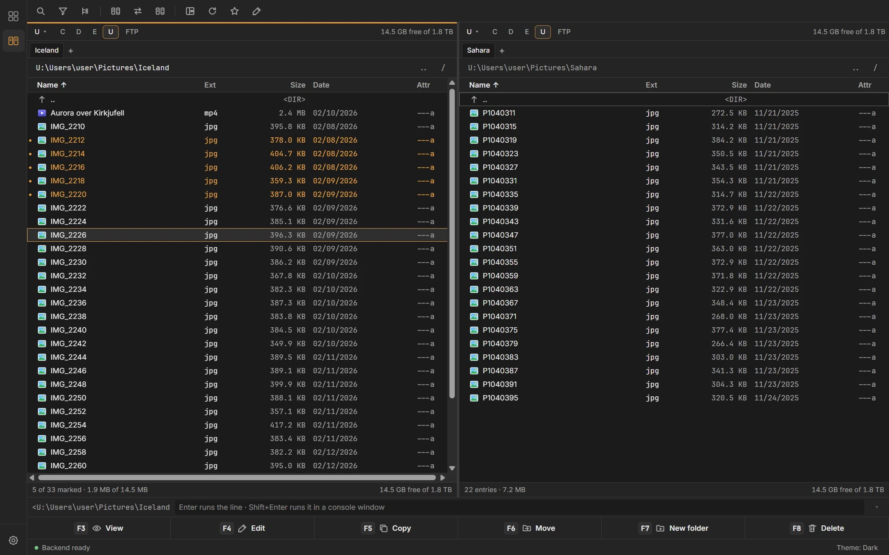


## Why

Two-panel file managers are still one of the quickest ways to work with files, and Total Commander has set the
standard for them for more than thirty years. Panelyth began with respect for that way of working and a wish to have
it in an interface made for today's screens and folder sizes, next to a media browser good enough to be an app of its
own.

So Panelyth is two apps in one window:

- the **Commander** for managing files with the keys many hands already know;
- the **Viewer** for looking at photos and videos.

A rail on the left, or Ctrl+Shift+M, switches between them. The other app opens in the folder you are in, and what
you selected comes with you. Bookmarks, recent folders and appearance are shared.

## The Commander

- **Two panels, three views.** Full with sortable columns, Brief, and Thumbnails; tabs in each panel.
- **The Total Commander keyboard.** Tab between the panels, F5 to copy, F6 to move, Insert to mark. Every shortcut can
  be remapped.
- **A queue for the heavy work.** Copy, move and delete run in the background with progress, pause and a dialog for
  conflicts, while both panels stay usable.
- **Find, compare, synchronize.** Find files by name, content, size, date or attributes; compare and synchronize two
  folders; compare files line by line; create and verify checksums.
- **Archives and servers as folders.** Enter zip and tar archives like folders, pack and unpack, and connect to FTP
  and FTPS servers.
- **And the rest of the toolbox:** a multi-rename tool with undo, a quick view of the file under the cursor, a lister
  for text, hex, pictures and video, and a command line that remembers the commands you ran (Alt+F8).
- **Panels the way you read them.** The eye in the path bar switches hidden and system files and the panel's view;
  folders stay in name order while the files are sorted by size or date; recent dates can read "yesterday at 14:05"
  in the system's format or ISO.
- **Layouts in one click.** Presets in the title bar set the whole window: details, list, tree, gallery, preview,
  stacked, or Single, one panel across the window as thumbnails.


<p>
  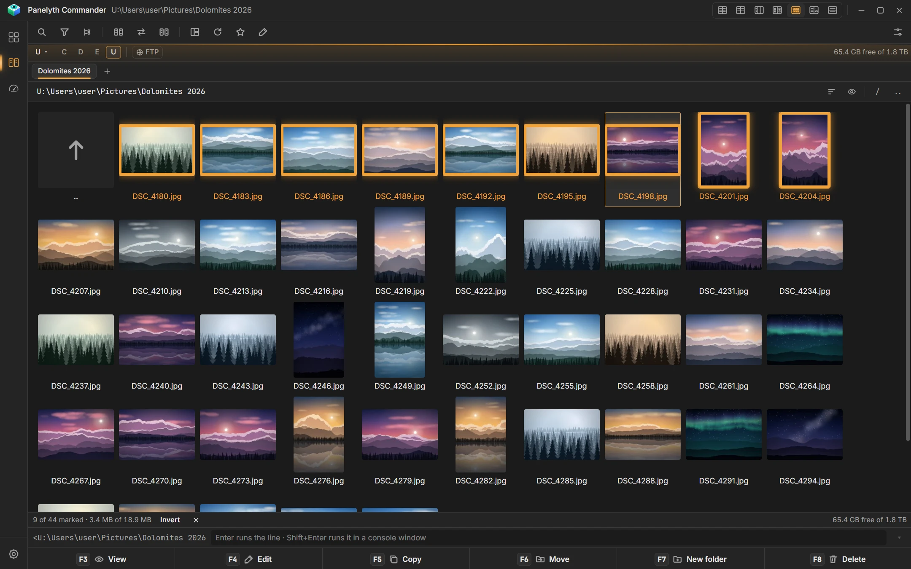
  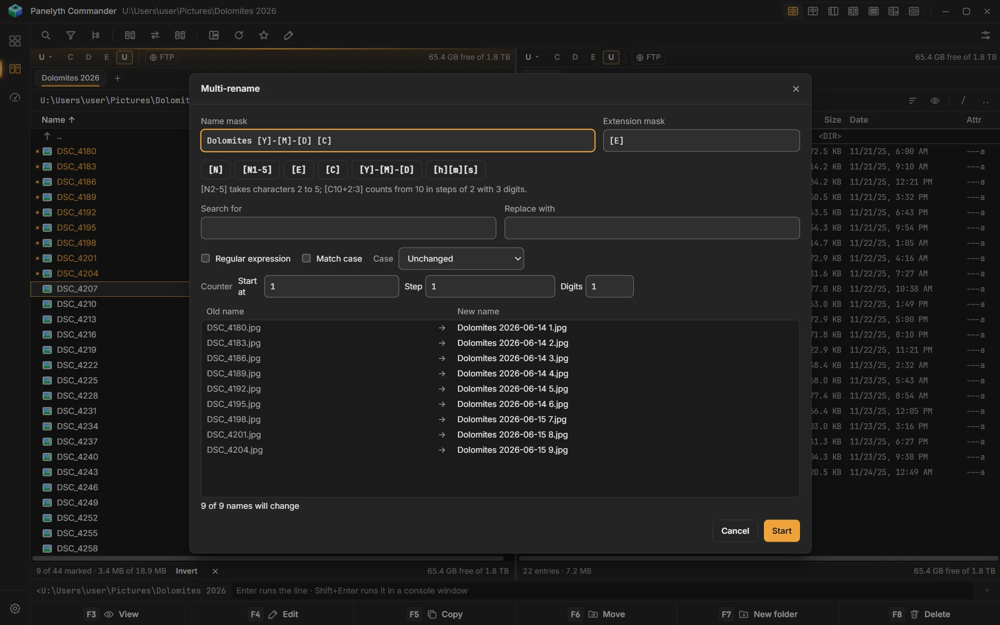
  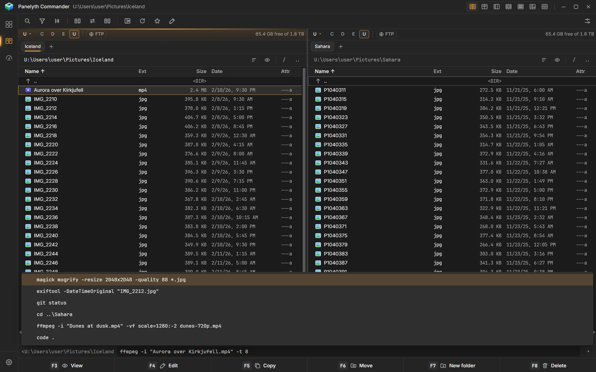
</p>

<p>
  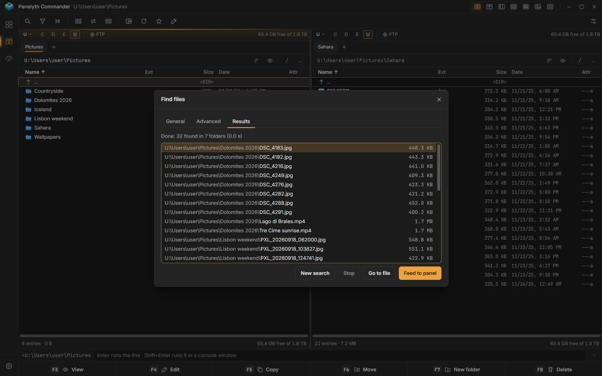
  
  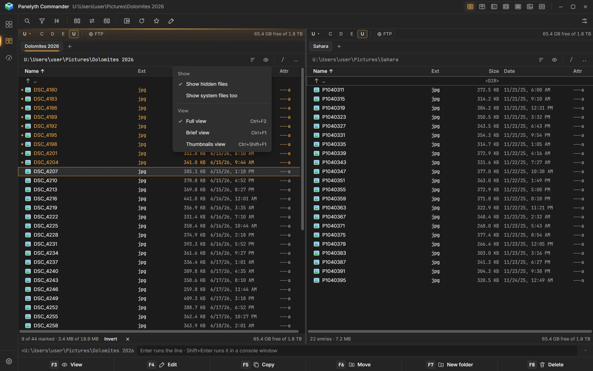
</p>

## The text and Markdown editor

F4 opens text, code and Markdown in an editor window of its own. **Live** shows Markdown as the finished page while
you type, **Preview** draws tables and task lists, and **Source** shows every character. Find and replace, word count,
code and config files in their colours, pictures dropped in or pasted (saved next to the note), and a clean PDF export
on white paper. Saving puts the file back whole, never half written.

<p>
  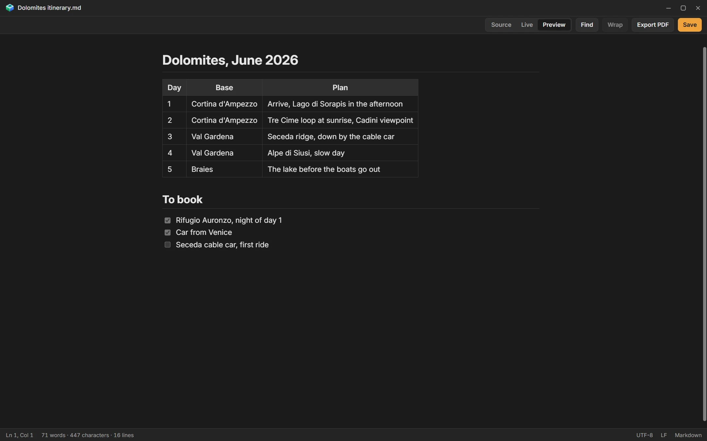
  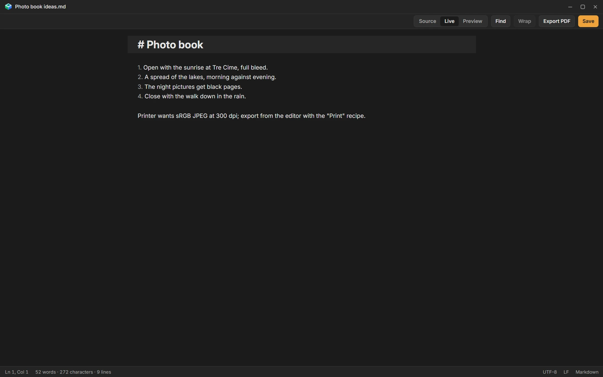
  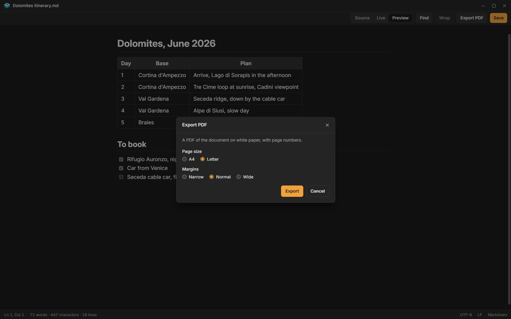
</p>

## The Viewer

- **Tiles for very large folders.** Small, medium or large tiles that reflow with the window. Only what is on screen
  is drawn, so a folder of 100,000 pictures scrolls like a folder of a hundred.
- **A closer look.** Zoom and pan a picture, play local video, and step through the folder with the arrow keys or the
  wheel. Thumbnails are cached, so a second visit to a folder is immediate.
- **Search, sort and filter**, with favorites, ratings and tags, and bookmarks and recent folders beside the folder
  tree.
- **An image editor.** Crop and straighten, adjust light and color with levels and curves, add borders and
  watermarks, retouch. A set of steps can be saved as a recipe and run over a whole folder.

<p>
  
  
  
</p>

## Three styles

Both apps come in three design styles, chosen in Settings → Appearance, and every theme works in each: **Classic**,
flat and neutral; **Liquid glass**, translucent panels over a soft wallpaper; and **Terminal**, a console with framed
panels and monospaced type, where the themes become Phosphor, Ice, Amber and three paper dossiers.

<p>
  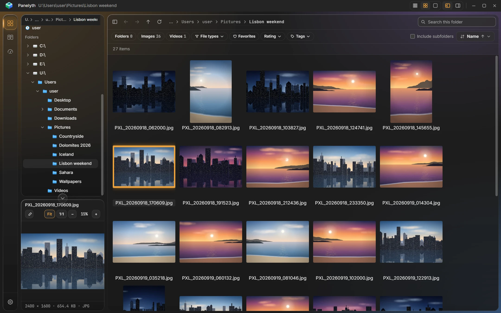
  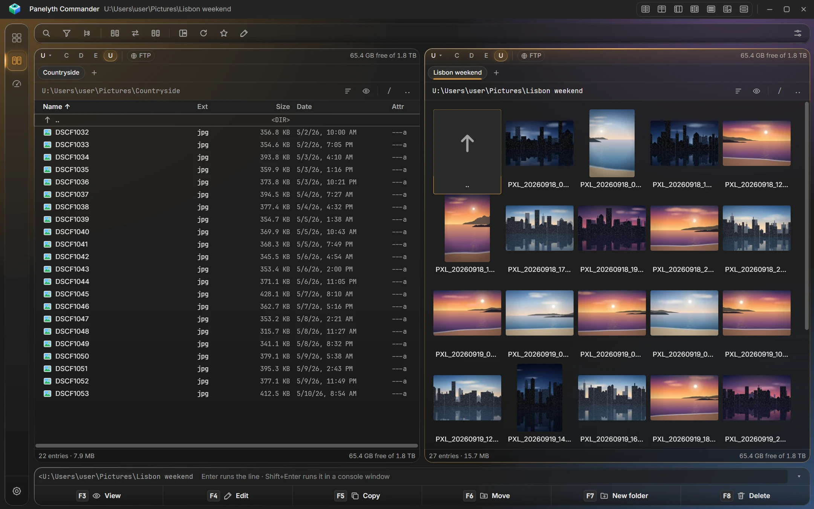
  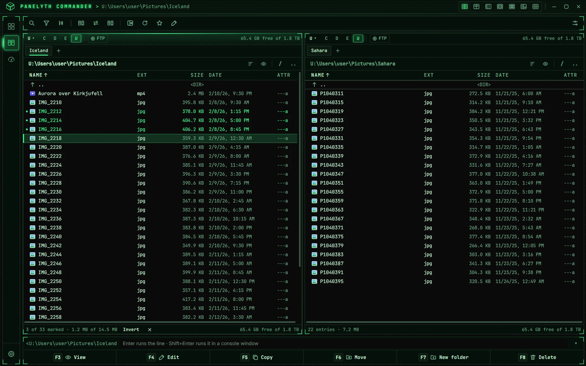
</p>

The screenshots are taken from the app itself, on a library of generated pictures;
[`showcase/README.md`](../showcase/README.md) says how to take them again.

## Download and status

Panelyth is in active development and the first public release is being prepared. Installers for Windows, macOS and
Linux will be published on the [releases page](https://github.com/petter-ka/panelyth/releases), each with a checksum,
and the app updates itself from Settings → About. [`docs/INSTALL.md`](INSTALL.md) covers installing, updating,
where the app keeps its files and how to remove it.

Where the work stands: both apps and the release pipeline are built and tested on Windows; the runs on macOS and
Linux and the signed builds are still open. [`docs/DEVELOPMENT-STAGES.md`](DEVELOPMENT-STAGES.md) has the current
state and [`docs/ROADMAP.md`](ROADMAP.md) the order of what comes next.

## How it is built

- **React and TypeScript** for both interfaces, virtualized so that the number of mounted rows and tiles follows the
  window, not the folder.
- **Electron** as one shell with one window; each app is a view of its own with only the permissions it needs.
- **A Go sidecar** for everything heavy: the folder index (SQLite), thumbnails and previews, the cache and file
  operations.
- **Local only.** No web backend and no cloud service; the preview cache lives in the system's cache folder, never
  beside your pictures.
- **Open source.** Panelyth's code is public under the MIT License ([`LICENSE`](../LICENSE)): read it, build it
  yourself, change it.

Performance is a requirement here, with budgets that are measured and recorded
([`docs/shared/PERFORMANCE.md`](shared/PERFORMANCE.md)). The rest of this page is for people working on the code.

## Development

Prerequisites: Node ≥ 22.12, pnpm 10, Go (current stable).

```sh
pnpm install
pnpm dev            # sidecar + Electron + Vite dev server (renderer HMR)
pnpm build          # sidecar + main/preload + renderer
pnpm start          # run the production build unpackaged
pnpm lint           # eslint + prettier + gofmt + go vet
pnpm typecheck
pnpm test           # contracts, desktop, renderer, Go
pnpm test:e2e       # Playwright against the built Electron app
BENCH_STAGE=02 pnpm bench:startup   # startup / idle memory / IPC → src/shared/bench/results/ (never overwrites)
BENCH_STAGE=02 pnpm bench:index     # scan / write batches / paging on 100k files
BENCH_STAGE=02 pnpm bench:previews  # thumbnail throughput, cache hits, coalescing
pnpm bench:go       # Go micro-benchmarks
pnpm package        # installers for this OS (docs/RELEASING.md); --dir for the unpacked app
pnpm test:smoke     # the packaged smoke test
```

`pnpm install` also points git at `.githooks` (`scripts/hooks.mjs`): before every push, `pnpm lint` and
`pnpm test` run, and a failure stops the push. `git push --no-verify` skips them.

These commands build and run the shell with the viewer. The commander joins them in Stage C00, behind a feature
flag (`PANELYTH_COMMANDER=1`). Stage P01 lets `BENCH_STAGE` take platform and commander stage IDs (`P01`, `C03`).

Logs: Electron `app.getPath("logs")/panelyth.log` (main process and sidecar stderr).

## Documentation map

```text
CLAUDE.md                      working rules for Claude Code (stays in the repository root)
LICENSE                        the MIT License of Panelyth's own code
docs/
  README.md                    this file: overview, map, reading order, ADR index
  ROADMAP.md                   phases of every track and the order across tracks
  DEVELOPMENT-STAGES.md        stage gates, stage IDs, sequence, completed and active stages
  STAGE-TEMPLATE.md            template for new stage documents
  RELEASING.md                 how a release is built, signed, tested and published; the release rules
  INSTALL.md                   for users: install, update, data locations, uninstall, known limits
  shared/                      the platform, used by both apps
    REQUIREMENTS.md            platform requirements (FR-20, FR-21, NFR-01…NFR-14)
    PRODUCT-PRINCIPLES.md
    ARCHITECTURE.md            processes, sidecar, IPC, index, jobs, watching
    ARCHITECTURE-ANALYSIS.md   historical Stage 00 analysis
    DOMAIN-API.md              renderer-facing API map
    CACHE-DESIGN.md            preview cache contract
    PERFORMANCE.md             strategy and platform budgets
    TESTING.md                 layers, harness, fixtures, benchmarks
    DESIGN-SYSTEM.md           tokens, themes, typography, motion, keyboard foundation, app switch rail
    APP-SWITCHING.md           the switch between the apps and the state they share
    decisions/                 shared ADRs
    stages/                    platform stages P01…P06
  viewer/                      Panelyth (photo and video viewer)
    BRS.md                     viewer requirements (FR-01…FR-19, FR-23)
    FEATURE-MATRIX.md
    ARCHITECTURE.md            workspace, tile view, preview pane, focused viewer
    UX-DESIGN.md
    PERFORMANCE.md             viewer budgets and recorded baselines
    TESTING.md                 viewer e2e scenarios and fixtures
    decisions/                 viewer ADRs
    IMAGE-EDITOR.md            image editor spec: features, UX, batch, stages 12–16
    stages/                    viewer stages 00…08.6 and 12…16
  commander/                   Panelyth Commander (dual-panel file manager)
    BRS.md                     commander requirements (CFR-01…, CNFR-01…)
    FEATURE-MATRIX.md          Total Commander features → stages
    ARCHITECTURE.md            panels, listing, file operations, lister, archives
    UX-DESIGN.md               layout, panels, dialogs, default key map
    PERFORMANCE.md             commander budgets
    TESTING.md                 commander e2e scenarios, fixtures, safety tests
    decisions/                 commander ADRs
    stages/                    commander stages C00…C11 (C10.5 between C10 and C11)
```

Rules for placing a document: shared platform behavior goes to `docs/shared/`; anything only one app has goes to that
app's folder. ADR numbers are global across the folders. Paths in documents are written from the repository root
(`docs/shared/ARCHITECTURE.md`).

## Start here

Claude Code should read these files in this order:

1. `CLAUDE.md`
2. this file
3. `docs/DEVELOPMENT-STAGES.md` (which stage is active, in which track)
4. `docs/shared/REQUIREMENTS.md` and the BRS of the app being worked on (`docs/viewer/BRS.md` or
   `docs/commander/BRS.md`)
5. `docs/shared/ARCHITECTURE.md` and the app's `ARCHITECTURE.md` (and `docs/shared/APP-SWITCHING.md` when the work
   touches both apps)
6. `docs/shared/PERFORMANCE.md` and the app's `PERFORMANCE.md`
7. `docs/shared/CACHE-DESIGN.md` when previews are involved
8. `docs/ROADMAP.md`
9. the relevant ADRs (index below)
10. the stage document being implemented

## Decisions (ADR index)

| ADR | Title | Scope | Status |
|---|---|---|---|
| 0001 | Electron + React + Go sidecar | shared | Accepted |
| 0002 | Sidecar IPC | shared | Accepted |
| 0003 | Persistent preview cache on the OS cache drive | shared | Accepted |
| 0004 | Virtualized tile view (tiles only) | viewer | Accepted |
| 0005 | SQLite local index | shared | Accepted |
| 0006 | Decoder abstraction | shared | Accepted |
| 0007 | Three-pane workspace (historical) | viewer | Superseded by 0023 |
| 0008 | Search and sort through SQLite | shared | Accepted |
| 0009 | Local video playback | shared | Accepted |
| 0010 | Asynchronous batch file operations | shared | Accepted |
| 0011 | Renderer state management | shared | Accepted |
| 0012 | Wire protocol and contract source of truth | shared | Accepted |
| 0013 | Build tooling and workspace layout | shared | Accepted |
| 0014 | Design system adoption (Tailwind CSS + shadcn/ui) | shared | Accepted |
| 0015 | Directory-centric index and scan scope | shared | Accepted |
| 0016 | Disposable index vs durable user data | shared | Accepted |
| 0017 | Query sessions and selection descriptors | shared | Accepted |
| 0018 | Video posters and probing via ffmpeg/ffprobe | shared | Accepted |
| 0019 | Native dependency (cgo) policy | shared | Accepted |
| 0020 | File watching scope | shared | Accepted |
| 0021 | Batch jobs, delete/clipboard/rename semantics, user metadata | shared | Accepted |
| 0022 | Extensibility foundations: keymap, labels, collections, transforms | shared | Accepted |
| 0023 | Two-column workspace | viewer | Accepted |
| 0024 | Folder covers | viewer | Accepted |
| 0025 | Product family: two apps on one platform | shared | Accepted; process model and data superseded by 0031 |
| 0026 | Index scope: all entries stored, filtered per query | shared | Accepted with amendments (Stage P02) |
| 0027 | App capability profiles: allowlists, shell actions, launching | shared | Accepted in full (C10, 2026-10-11): allowlists (P01), launching (C05), the command line and user commands (C10) |
| 0028 | Commander panels: dual-panel layout, TanStack Table (table view) and virtualized lists | commander | Accepted (Stage C01) |
| 0029 | File-operation engine v2 | shared | Accepted (Stage P03, 2026-10-06) |
| 0030 | Archives as folders | commander | Accepted (Stage C07) |
| 0031 | One shell for both apps: app switching and shared state | shared | Accepted |
| 0032 | Packaging and release builds (electron-builder) | shared | Accepted (Stage P04) |
| 0033 | Document window: PDFs and text in a window of their own; the media window; files opened from the OS | shared | Accepted (owner request; amended 2026-10-12) |
| 0034 | Localization: eight languages, English text as the key | shared | Accepted (owner request) |
| 0035 | Image editor engine: sessions, proxy rendering, save semantics | viewer | Accepted with amendments (Stage 12, 2026-10-12; notes from Stages 13 to 15) |
| 0036 | Batch image editing: recipes, edit jobs, output rules | viewer | Accepted with amendments (Stage 16) |
| 0037 | Remote locations: FTP connections as folders | commander | Accepted with amendments (Stage C10.5) |
| 0038 | Updates, the native menu and the release pipeline | shared | Accepted (Stage P06) |
| 0039 | Settings in a native window that blocks the main window | shared | Accepted (owner request) |
| 0040 | Dragging files to other apps (the OS drag, paths resolved in main) | shared | Accepted (owner request) |
| 0041 | Liquid glass style beside the classic one (a shared appearance setting) | shared | Accepted (owner request) |
| 0042 | Panelyth System, the third app (a dashboard of the computer and a search across volumes) | shared | Accepted (owner request) |
| 0043 | Git in the commander (the installed Git; status per folder, background runs, badge, row marks, Git bar) | commander | Accepted (owner request) |
| 0044 | "Open with" programs from Settings (picked in main's dialog, started without a shell, both apps) | shared | Accepted (owner request) |
| 0045 | The window's title strip (Windows: the apps draw the title, the folder and the window buttons, in the theme) | shared | Accepted (owner request) |
| 0046 | Text and Markdown editor (a window of its own, sessions, CodeMirror 6, atomic save, PDF, FTP save) | commander | Accepted with amendments (Stage C10.6) |
| 0047 | Terminal style (a third design style: a console for each theme, framed panels, monospaced type) | shared | Accepted (owner request) |

Files: `docs/<scope>/decisions/ADR-<number>-<slug>.md`.

## Project principle

Do not optimize by intuition. Add instrumentation, reproduce the bottleneck, measure, change one thing, measure again.

The target is not merely fast startup. The target is apps that still feel fluid in directories containing tens or
hundreds of thousands of files.

## License

Panelyth is open source under the [MIT License](../LICENSE). The libraries and tools it includes keep their own
licenses; the app lists them under Help → Third-Party Licenses.
